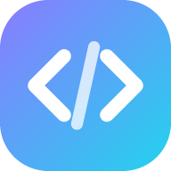

# CodeMentor

**An offline coding mentor for students.** Paste an error or your code, and CodeMentor explains what went wrong, shows the fix, and teaches the concept behind it, all without an internet connection.

  



- 🐞 **Error decoder:** 80+ error types across Python, JavaScript/Node/React, Java, C/C++, SQL, Git and terminal problems
- 🔍 **Code analyzer:** finds bugs with line numbers (missing colons and semicolons, `scanf` format mistakes, off-by-one loops, typos, infinite loops…) and auto-fixes the safe ones
- 🧠 **Concept library:** 45 topics with analogies, multi-language examples, common mistakes and quizzes
- ▶️ **Playground:** runs JavaScript in a sandbox, and Python/C/C++/Java using the compilers on your computer
- 🔐 **Private by design:** local accounts, device-bound sessions, and no servers, analytics or tracking

No build step and no dependencies: plain HTML, CSS and JavaScript, plus a ~300-line Node.js launcher.

## Quick start

**Windows:** install [Node.js](https://nodejs.org) (LTS), then double-click **`Start CodeMentor.bat`**.

**macOS / Linux:**
```sh
./start.sh          # or: npm start
```

Your browser opens at **http://localhost:4317**. In Chrome or Edge, click **Install app** in the address bar to use it as a desktop app.

No Node.js? Open `app/index.html` directly in a browser. The mentor, library and JavaScript playground work, but running Python/Java/C needs the launcher.

## Features

| Area | Details |
|---|---|
| **Chat** | Explains *what happened, where, why, how to fix it* and *the concept behind it*. Simple / Balanced / Deep answers, follow-ups ("simpler", "show it in Java", "quiz me", "explain line by line"), suggested next questions |
| **Code review** | Line-by-line walkthroughs, estimated time complexity with reasons, corrected code with the changed lines highlighted |
| **Playground** | Editor with highlighting and smart indent, program input (stdin), live problem markers, one-click fixes, "Explain this error". Asking the chat "what's wrong with my code?" uses the Playground's code |
| **Library** | Concepts, an error encyclopedia, code recipes in 5 languages, comparisons ("== vs ===", "abstract class vs interface"…), interactive quizzes and learning progress |
| **Accounts** | PBKDF2-SHA256 password hashing, lockout after repeated failures, sessions bound to a device fingerprint, trusted-device list, security activity log |
| **Profile** | Details, stats, streaks, activity heatmap, achievements |
| **History & saved** | Searchable chat history, pin/rename/export, saved snippets, JSON backup and restore |
| **Optional local AI** | Connect Ollama or LM Studio (still offline). The model receives CodeMentor's verified analysis as context, and the built-in engine is the fallback |

## Privacy

Everything stays on the user's computer:
- Accounts, chats and snippets are stored in the browser's IndexedDB. There is no server-side database.
- The launcher listens on `127.0.0.1` only, rejects requests from other websites (Host and Origin checks plus a required header), runs code with time and output limits, and deletes temporary files.
- The app makes no external network requests: no CDN, fonts, analytics or telemetry.

## Known limitations

- **Data lives in the browser.** Clearing the browser's *site data*, or switching browsers, starts fresh. Use Settings → Data → Export for backups.
- **The built-in engine is a curated knowledge base plus heuristics**, not a general AI. For questions outside it, connect a local model.
- **Running code needs compilers on your PC:** Python 3, a JDK 11+ for Java, and gcc/g++ for C/C++.

## Project structure

```
codementor/
├─ Start CodeMentor.bat / start.sh   launchers
├─ server.js                         static server + local code runner (no dependencies)
├─ tests/                            engine tests (npm test)
└─ app/
   ├─ index.html, sw.js, manifest.webmanifest, icons/, css/
   └─ js/
      ├─ core/     utilities, IndexedDB, hashing + device fingerprint, auth
      ├─ render/   syntax highlighter, Markdown renderer
      ├─ kb/       knowledge base: concepts, errors, recipes, comparisons, FAQs
      ├─ engine/   search (BM25), code analyzer, answer engine ("brain"), runner, local-AI connector
      └─ ui/       views: auth, chat, history, library, playground, saved, profile, settings
```

## Contributing

Contributions are welcome, especially new knowledge-base entries and analyzer checks.

1. Fork the repo and create a branch.
2. Make your change.
3. Run the tests: `npm test` (no install needed).
4. Open a pull request describing what you changed and why.

### Adding knowledge

Knowledge-base files in `app/js/kb/` are plain JavaScript. Inside the text, write inline code as `«code»` and code blocks with `~~~lang` fences (they're converted automatically), so the content fits in template literals.

**A new error type** (`errors-*.js`): `re` patterns capture details from the real message, and `$1`, `$2` insert them into the text:
```js
{
  id: 'py-example', lang: 'python', title: 'ExampleError: something went wrong',
  re: [/ExampleError:\s*(.+)/i], kw: ['exampleerror'], dflt: ['the value'],
  what: 'Plain-words explanation mentioning «$1».',
  causes: ['Most common cause…', 'Another cause…'],
  fix: `~~~python bad\nbroken()\n~~~\n~~~python good\nfixed()\n~~~`,
  concept: 'The idea behind it.',
  related: ['functions']
}
```

**A new concept** (`concepts-*.js`) needs `id`, `title`, `cat`, `aliases`, `summary`, `explain`, and ideally `analogy`, `code` (per language), `mistakes`, `quiz` and `related`.

**A new analyzer check** goes in `app/js/engine/analyzer.js`: push `{ line, severity, title, detail, patch? }` onto `issues`. A `patch` (the corrected full line) enables auto-fix.

Please add a test case for new behaviour in `tests/cases/*.json`:
```json
{ "q": "the question a student would type", "expect": "regex the answer must match", "reset": true }
```

## License

[MIT](LICENSE). Free to use, modify and share.
